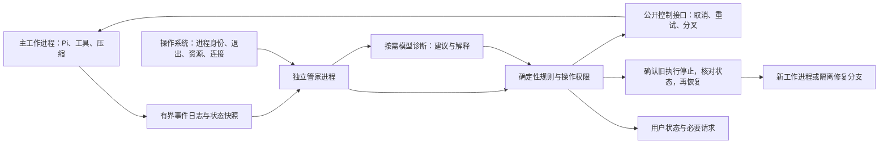

# 托管运行管家：可行性与恢复机制

研究日期：2026-10-25。范围为个人多仓库 Agent；本文是研究与未来设计，不启用托管运行、不开发新守护进程，也不改变当前升级的验收标准。本文以当前源码和核读的官方资料为依据，既有升级完成后还应结合最终实现更新。

## 1. 结论与定位

独立管家有价值：目标模式负责继续工作，管家负责发现执行是否失去响应、是否反复失败，以及恢复动作是否真的结束。两者可以配合，但持续续跑不自动包含进程故障恢复。对于压缩阻塞、工具失联、后台状态丢失等问题，独立进程比主 Agent 内的另一段提示词可靠；主进程的事件循环阻塞时，同进程的观察与问询也可能一起停止。

建议未来采用“确定性监控与权限规则负责控制，模型按需诊断并提出方案”的方式。时间过长是调查触发条件，不直接证明方法错误。自动管家必须保护原目标和验收要求，不能通过删除耗时检查、修改断言或把未知状态改成成功来结束任务。

现有 `managed` 模式只协调仓库工具与记录，不能据此宣称已有外部托管管家。当前观察旁路是良好基础，尚未实现完整的外部干预与自修复闭环。现有扩展（本地参考文件）、观察实现（本地参考文件）

## 2. 现有公开方案已经做到什么

| 方案 | 核实的能力 | 对管家的启发与边界 |
|---|---|---|
| Pi 1.4.0 | 公开压缩事件、自定义摘要入口、压缩失败事件、SDK 取消压缩和运行的接口 | 可以设计兼容的恢复适配层；主进程卡死时仍需外部措施。文档和声明不能代替实际故障验证。本地压缩文档（本地参考文件）、SDK 声明（本地参考文件） |
| Codex App Server | 目标、运行状态、压缩生命周期、取消和分叉等公开接口 | 有控制与观察接口不代表自动诊断、自修复已经完整。核读文档中旧 `thread/rollback` 已移除；适配必须按实际协议选择恢复入口。[官方文档](https://learn.chatgpt.com/docs/app-server) |
| Claude Code | 检查点，以及压缩前后、API 失败等 hooks | 可以组合外围通知与控制；某些 hooks 的输出不会改变流程，不能假设每个 hook 都能取消或重试。检查点也有 shell、并发会话和子 Agent 变更覆盖边界。[检查点](https://code.claude.com/docs/en/checkpointing)、[hooks](https://code.claude.com/docs/en/hooks) |
| LangGraph | 持久检查点、回放、按节点超时/重试/错误处理 | 很接近可恢复执行框架；回放会重新执行后续节点，外部调用仍需幂等或显式补偿。[持久化](https://docs.langchain.com/oss/python/langgraph/persistence)、[故障处理](https://docs.langchain.com/oss/python/langgraph/fault-tolerance)、[回放](https://docs.langchain.com/oss/python/langgraph/use-time-travel) |
| Magentic-One | 记录任务与进展，足够多步没有进展时重新规划 | 语义层的纠偏已存在，不能把“另一个 Agent 看进展”本身当成新发明；它与外部进程救援仍是不同能力。[官方说明](https://microsoft.github.io/autogen/stable/user-guide/agentchat-user-guide/magentic-one.html) |
| Wink，2026 年研究 | 异步观察 coding agent 轨迹，对偏离要求、重复行为和工具调用错误给出纠偏提示 | 与旁路管家最接近的公开先例；主要是行为纠偏，不是操作系统进程救援或多仓库事务回退。[原论文](https://arxiv.org/html/2602.17037v2/) |
| OpenHands SDK | 自动保存会话状态，提供持久会话使用方式 | 可恢复的会话记录是基础；仍需核对命令、服务和外部副作用，不把保存成功当成全部工作已恢复。[官方文档](https://docs.openhands.dev/sdk/guides/convo-persistence) |

这些事实来自产品文档、接口与代码；没有完成全市场部署调查，也没有验证各产品在同一故障集上的实际可靠性。较明确的设计机会是将故障恢复、状态一致性、原验收保护与用户可核对的恢复记录组合成一个个人工具。

Wink 的“恢复”主要由模型裁判检查干预后若干步骤中的原问题是否消失且有前进，不等同于整项工程通过独立验收。其试验来自 Meta 的环境，作者也明确限制泛化；执行时间改善未达到文中采用的显著性标准。因此它支持“旁路纠偏可试”，不能用其结果承诺个人 Pi 工作流一定更快、更少出错。[评价定义与局限](https://arxiv.org/html/2602.17037v2/)

## 3. 推荐架构

管家不占主工作区锁，不把每次观察变成一次模型请求。默认读取事实日志，只有出现异常才做有界诊断。同一个 Gateway 服务仍可能共享资源，增加一个会话不保证诊断请求更快；优先确保本地规则在模型不可用时也能工作。

最小状态应包括任务和会话标识、运行代次、阶段、开始时间、观察新鲜度、进程启动身份、最近源码/证据变化、重试原因、操作效果分类和下一项期待事件。必须分别表示“进程活着”“有输出”“有新的任务证据”“通过验收”，避免用心跳冒充进展。当前事实记录（本地参考文件）、当前独立状态问答（本地参考文件）

外部管家应有自己的退出、容量和重启预算。管家损坏或与工作进程断连时，默认限制新干预；不让两个管家同时取消、恢复或指挥写入。运行代次与写入资格核对用于防止旧进程在恢复后继续写文件。宿主命令不是 OS 沙箱，单靠应用内代次无法拦住已经逃逸的任意 shell 子进程。

### 3.1 线程、进程和模型如何分工

| 部分 | 负责什么 | 失效时的限制 |
|---|---|---|
| Pi 插件内的事件镜像 | 报告模型、压缩、工具、审批与验收的已知阶段 | 主事件循环阻塞时也可能停止更新；不能承担唯一的救援职责 |
| 独立本地守护进程 | 检查进程身份、日志新鲜度、阶段期限、未结算操作和控制应答 | OS 证据只能判活性，不能判语义进展；断连先标未知 |
| 按需诊断模型 | 根据有界记录解释异常，提出下一步调查或路线调整 | 不能依赖读取隐藏思维；与主 Agent 共用 Gateway 时可能同时拥塞 |
| 控制适配器 | 使用公开接口取消、重连、重启或准备恢复 | “接受取消”与“执行停止”分成两项；后者没有证据时禁止恢复写入 |
| 可独立重启的展示层 | 呈现主任务与管家事实，接收用户接管 | 展示失败时任务日志仍可读取；避免为了修页面重跑已完成任务 |

因此，增加同进程线程可以帮助展示，真正处理主进程挂死仍建议独立进程。外部常驻模型循环不是必需项。守护进程先问“当前等什么、期待什么事件、谁能产生它”，只有确定性记录不足时才请求诊断。

### 3.2 可调整的托管级别

以下是未来配置建议，等级对应事先选定的动作授权，而不是每次都弹出确认。

| 级别 | 允许的动作 | 升级条件 |
|---|---|---|
| 观察 | 显示阶段、异常与未确定状态，写本地诊断记录 | 先证明误报和观察成本可接受 |
| 运行恢复 | 有限取消/重试，重连 UI，重启已确认退出的拥有进程 | 证明取消终态、运行代次与重试预算有效 |
| 方案恢复 | 预览后回退 Agent 自己的可逆修改，开新方案分支，留下带版本的失败理由 | 证明用户修改、原验收和外部副作用均正确处理 |
| 隔离维修 | 在另一个工作区修允许替换的适配器，运行故障案例，待安全边界切换版本 | 证明补丁来源、兼容性和退回路径；权限/验收逻辑不能自行放宽 |

每次进入恢复还需核对该级别的权限；读了新的网页、日志或技能不能提高等级。人工接管立即停止新恢复派发，主运行与管家共享最新用户指令的版本。

## 4. 具体故障的处置

| 实际情况 | 首先确认 | 可尝试的恢复 | 不能自动得出的结论 |
|---|---|---|---|
| 模型请求久无响应 | 请求阶段、连接/错误、预算、服务是否拥塞 | 取消已超限请求，有限重试；只有许可且适配兼容时才切换后端 | 无输出不等于模型没有计算 |
| 验证很慢 | 首次构建、下载、测试死锁还是正常慢测；原检查覆盖了什么 | 取消本次尝试；缓存、分阶段检查或提出等价替代，保留原检查和版本 | 不能删除检查后宣布原需求已验证 |
| 压缩 API 失败 | 是失败、取消、输入超限、输出不足还是认证问题 | 结束失败请求；有界重试，或通过公开入口生成较小摘要；认证问题交给用户 | 反复重试不会自动解决无权限 |
| 压缩卡在内部等待 | 当前压缩请求是否仍活跃，控制通道是否有响应，摘要是否已提交 | SDK 取消并等待终态；通道失效时保存诊断后终止工作进程；从最后有效会话状态重建 | 不能把取消请求的应答当成执行已经停止 |
| UI/渲染框架异常 | Agent 是否实际仍在工作，事件流和持久日志是否正常 | 重连或重启展示层；必要时改用 headless 工作进程继续 | 页面卡住不等于需要回滚代码 |
| 主进程死亡/事件循环阻塞 | OS 启动身份、子进程、遗留锁及未结算操作 | 确认停止后做领域恢复；未知效果先核对；必要时开新分支继续 | 不能只看到旧日志就确认仍活着或已完成 |
| 获取不到 CI/后台终态 | 是无事件通道、鉴权过期、连接问题还是外部任务未结束 | 补有界轮询/日志适配器或本地通知产物；仍无法取证时保持未验收 | 发出了通知不等于取得验证结果 |
| 重复同一错误或阅读 | 参数、源码版本、输出和问题是否相同 | 记录失败条件，做小实验检查假设，再换路线 | 修改过代码后重新跑测试通常是正常验证 |

Gemini CLI 的公开实现已经区分真正的重复循环与批量操作、不同修改后的复验；管家也需要类似区分，而非计数达到阈值就否定操作。[循环检测代码](https://github.com/google-gemini/gemini-cli/blob/main/packages/core/src/services/loopDetectionService.ts)

### 4.1 压缩卡住的一次完整处理

1. 记录压缩开始时的会话节点、待保留的最新要求、调用标识和摘要是否已提交。阶段软期限触发调查，硬期限来自本次操作预算；具体值需从实测校准。
2. 分别检查工作进程和旁路是否更新。主任务心跳更新而压缩没有输出，不足以判死；主任务完全无响应而 OS 进程仍存在，也只能标“疑似阻塞”。
3. 若压缩已经提交而 UI 未更新，只重建展示/投影；没有提交且控制通道可用，通过公开 SDK 取消压缩并等终态。
4. 无法取得终态时，收集诊断并按拥有关系结束工作进程，确认相关工具/子进程与写入停止。未知外部效果仍未结算，不能直接重放。
5. 从最后有效的原始会话状态加载新进程；通过公开压缩入口重试或使用较小的有来源摘要。摘要生成失败时可以开新的交接会话，保留原会话、原要求和未解决项，不手改 Pi 私有历史。
6. 核对计划、最新用户要求、仓库状态和待验项目。摘要缺项必须回读原记录；原始记录损坏且无法重建时停止自动恢复，呈现缺口。
7. 记录本次恢复依据、取消终态、恢复版本和仍未知的效果。只有后续真实工作与原验收继续有效，才算恢复成功。

这里通常不需要回滚源码。若要否定原验证方法，应否定“这次尝试在这些条件下继续运行”，保留原要求并寻找等价取证路径；不能永久禁止该检查，也不能把一项长集成测试改成小测试后宣称同等通过。

## 5. 时光机如何参与

很多故障只需要取消或恢复运行，不需要回滚源码。时光机用于已确认的错误修改，或者开独立方案试验。完整处置顺序是：冻结新派发，记录故障，取消并确认旧执行静止，核对实际世界状态，预览恢复范围，实施可逆恢复，重新验证，再继续。

恢复包至少关联代码版本、会话节点、原目标与最新用户要求、计划修订、材料/记忆引用、有效证据、后台事件归属与累计消耗。文件和会话可以回退；模型调用费用、已发请求、远端数据库写入等不能假装回退。未知副作用保留未知，不直接重放。当前恢复预览（本地参考文件）、当前恢复实现（本地参考文件）

Kimi 的已合并 undo 改造明确修复了仅回退上下文而 Todo、Plan、任务通知未同步的问题，并要求执行静止后进入 undo；它说明状态协调确实是工程问题。该 PR 不证明全部外部副作用能撤销，也不能据此推断某次取消功能的全部动机。[Kimi 改造记录](https://github.com/MoonshotAI/kimi-code/pull/2055)

## 6. “现场修组件”的可行边界

替换验证运行器、状态采集器、通知适配器和压缩策略，比修改运行中的 Agent 内核更可控。建议先把故障组件做成有版本的可替换适配器；管家可在独立分支提出修改并执行回归，主进程在明确边界加载已验证的新版本。保留旧版本和退回入口。

任意热改主流程风险高：模块可能已载入内存，磁盘代码改变不等于运行实现改变；新旧版本可能共同处理一个会话；维修模型也可能误改权限与验收机制。推荐的升级顺序是“隔离修复 → 验证 → 结束旧运行 → 切换版本 → 重验”，而非在卡住的进程里边改边猜。

值得先允许维修的是可独立测试的采集、通知、压缩摘要与验证执行适配器。例如，补一个缺失的 CI 终态查询器，必须用真实返回值证明能区分运行中、失败、成功和无权限；查询器加载后还要重新取得原任务结果。给用户展示“当前无法取得终态”可以改善体验，但不能填补验收缺失。

不可由维修过程自行放宽的条件包括原目标、成功标准、权限、脱敏、来源角色、并发写入保护和未知效果禁止重放。管家可以提出新的验证手段，但必须证明覆盖关系或等待授权；缺证据时要如实保留缺口。

通知也应先使用本地工作台状态、文件或已授权通道。不能因为要做管家就擅自发 Slack、飞书或邮件，或临时开放远程管理接口。

## 7. 未来试验与验收

以下为未来建议，不在当前开发中实施：

1. **只观察**：建立主进程和旁路分别故障的样例，能区分健康慢任务、采集丢失与执行停滞；阈值按操作类别和冷/热启动分别校准。
2. **有限恢复**：允许取消一个超限动作、重连展示、有限重试；每次记录来源事实、动作、终态、耗时和是否保留原验收。
3. **协调恢复**：验证进程组终止、并发用户修改、计划/后台通知对齐和未知副作用；无法确认停止时不回滚写入。
4. **隔离维修**：只对明确适配器提出修改；用故障注入和完整回归证明修复没有改变成功标准。

需覆盖：静默但正常的长测试、API 限流、压缩响应丢失、压缩已提交但展示未更新、进程假死、PID 重用、僵尸子进程、观察器崩溃、两个管家竞争、过期后台事件、部分恢复和错误维修补丁。验收同时统计误杀健康任务、恢复成功、原验收保持、人工介入、重复副作用、总模型/运行成本；不能只统计自动继续了多少次。

所有候选干预都应先用“不真正干预”的观察对照检验：保存建议与实际后续结果，测量本来会正常完成的任务有多少被建议取消。之后比较总完成时间与最终正确率，计入守护/诊断开销；避免只报告少等待几分钟，却漏算重启后又做了一遍的成本。

## 8. 决策

未来值得优先探索的是“独立监控 + 可核对恢复”，随后是“保留成功标准的换路线”。任意内核热维修应后置。合理目标是处理事先定义的一组故障、解释剩余未知并交还用户，而非承诺无需人工就能修复所有 Agent 内部问题。

## 9. 当前收尾暴露出的真实例子

2026-10-25 工作台验收发现两个不同问题：立即取消后，Pi 初始化阶段仍可能继续派发模型和文件写入；后端已经空闲时，页面也可能因正在刷新而漏掉最后一次刷新。这两项已修复，本地类型检查和 134 项完整回归通过。它们是受控模型、实际文件和浏览器证据，不是托管管家已经实现的证明。[会话控制](../src/workbench-session.ts)、[页面刷新](../src/workbench-assets.ts)、[回归用例](../test/workbench.test.ts)

第一个问题要求管家核对“停止后的实际效果”，收到取消应答还不够；第二个问题要求把展示失效与工作失败分开，重连展示即可，不应回滚正确代码。

Windows 分阶段诊断后来确认一项状态发布故障：原子替换遇到 `EPERM`，写入队列随后无法发布终态。当前加入有界重试和失败终态处理。本地完整 136 项测试通过，新平台结果仍待确认。另一份诊断显示交接核对正在执行，但超出预算后正确退出为 timeout，不能把期限结果称为挂死或成功。管家应区分取证耗时、状态发布失败和真正的执行阻塞。

### 9.1 优先考虑的最小回溯

未来建议先决定需要恢复哪一层：页面投影、模型请求、工具尝试、方案上下文、代码。只恢复有证据失效的部分。例如验证器超时，先结束验证进程并保留未验收记录；只有证明当前实现路线错误，才预览回退对应改动。更细的回溯需跟踪读写依赖和并发用户修改，不能仅凭操作名称推断恢复范围。当前代码检查点不能据此宣称已经具备任意粒度的自动逆操作。

### 9.2 干预也需要验收

未来每次干预都应保留三个结果：原故障是否消失、原要求是否仍可验证、新增副作用是否已结算。页面重新显示、模型又开始输出或进程重启成功，只证明各自的局部状态。若同一故障多次出现，管家应停止重复恢复，保留可复现诊断和最小接管动作，避免主 Agent 与管家一起陷入修复循环。

建议先以影子模式记录“本来准备取消什么”，让正常任务自行结束，再比较误判。自动恢复上线后设置独立的诊断、重试、回溯和维修预算，计入总成本。管家在主后端拥塞时可退回本地状态解释与通知，不能把主请求排队变成两个模型请求共同排队。

来源采集记录与原文缓存：`<LOCAL_AUDIT_ROOT>/2026-10-25/enigma-next-research/supervision/`。网页反映核读时版本，产品文档、公开接口、论文设定与本地验证分别表达。通用搜索多次未返回有效结果，因此补充直接核读官方页面；没有将搜索空结果当成某能力不存在的证据。
